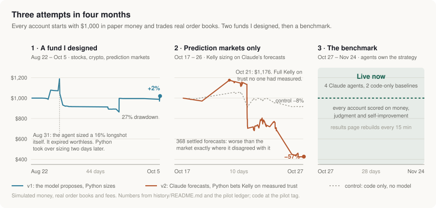
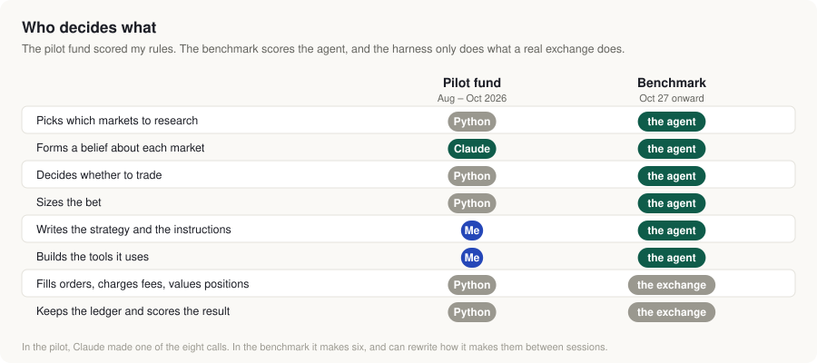
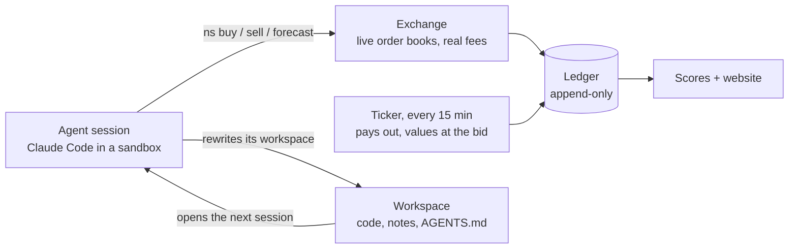

# Nightshift

**Can an AI agent make money trading prediction markets, and get better at it by rewriting its own code?**

[](https://github.com/Amadeus415/agentic_trading/actions/workflows/ci.yml)


[](LICENSE)

Nightshift is a live benchmark. Four Claude agents each get $1,000 of paper money and trade real Polymarket and Kalshi order books for 28 days, four sessions a day. Two of them keep and rewrite their own code, notes and instructions between sessions. The other two start from a blank workspace every time. Two code-only baselines trade beside them. Everything is scored against the market itself.

It took three attempts to get the question right. This README tells that story, then explains the benchmark it produced.

## The problem

AI agents are starting to work unattended for days at a time. Two questions decide whether that's a good idea, and today's benchmarks rarely test either one:

1. **Can an agent decide well when nobody knows the answer yet, and mistakes cost money?** Most benchmarks grade questions whose answers already exist: a test passes or a fact is right. Those answers can leak into training data, and a wrong one costs nothing.
2. **Does an agent get better when it can rewrite its own tools and instructions?** Self-improving agents are a common claim, but the claim is rarely tested against a control: the same agent, at the same moments, that can't keep its changes.

Prediction markets test both. Thousands of questions resolve every week, so there is nothing to memorize. The market price is a strong public forecast to beat. And spreads and fees make an agent that is merely as good as the market lose money.

## The experiment

<p align="center">
  
</p>

Each agent gets $1,000 in paper money, four work sessions a day, and four weeks. It trades real order books through one command, `ns`. Between sessions it can rewrite anything in its own workspace: its tools, its notes, and the `AGENTS.md` it reads at the start of the next session.

The control is an identical agent whose workspace resets every session. Both run at the same moments against the same markets, so any gap between them is what keeping its own code bought.

**v0.1 is live from October 27 to November 24, 2026:**

| Run | What it is |
| --- | --- |
| `opus-evolving-1`, `opus-evolving-2` | Claude Opus 5.5 in Claude Code. Keeps and rewrites its workspace. |
| `opus-frozen-1`, `opus-frozen-2` | The same model and prompt. Its workspace resets every session. |
| `favorites` | Code only: buys 90–97¢ favorites near close. The favorite-longshot bias. |
| `random` | Code only: buys random outcomes. Shows what spreads and fees cost. |

The results page rebuilds from the ledgers every 15 minutes, with a 95% interval on every number. It isn't hosted publicly yet; results will be published here when the window closes.

## How it got here

This repository started in July 2026 as an attempt to run an autonomous fund. Each attempt made the fund safer by moving one more decision out of the model and into code, until the fund was measuring me instead of the model. The benchmark is what came out of noticing that.

<p align="center">
  
</p>

### 1. A fund I designed

The first version, Edgecraft, was a paper fund across stocks, crypto and prediction markets. July went into the machinery: a backtest engine, a broker integration, risk gates, a dashboard. From August 22 a language model researched markets and proposed trades with a probability, a target and a stop, and Python sized them and enforced limits.

It ended up 2% after a 27% drawdown, decided by three trades. The agent's stated confidence meant little: 46 theses said 56% on average and 20% won. Stocks lost money in every view of the data, because an LLM reading public news is competing against the most efficient prices in the world. Prediction contracts were the only asset class that made money, and the wins came from reading settlement rules and primary sources quickly and literally. That is what language models are actually good at, so the next version traded nothing else.

### 2. Prediction markets only

Renamed Nightshift, the second fund traded only Polymarket and Kalshi. It logged a forecast for every market it researched, scored each one against the market price at that moment, and let a playbook bet bigger only once its forecasts had earned trust. A code-only control fund set the bar to beat.

It lost 57% in ten days, while the control fund lost 8%. The mechanism was clear in the data: across 368 settled forecasts, the model did worse than the market price exactly where it disagreed with it, and the sizing rules bet full Kelly on trust that had not been measured yet. One signal held: when the agent said a published source had already decided a contract the market still doubted, it was right 18 times out of 18.

### 3. The benchmark

A fund that loses 57% looks like a verdict on the model. It wasn't. Python picked the markets, decided whether to trade, sized every bet, and I wrote the playbooks. The model made one call in eight. The loss measured my rules.

<p align="center">
  
</p>

So the pilot was retired on October 26 and rebuilt as a benchmark in a day. The harness shrank to what a real exchange does: fill orders against the live book, charge the venue's fees, value positions at the bid, keep the ledger, score. Everything else became the agent's: which markets to look at, what to believe, whether and how much to trade, and the code and instructions it uses to decide. A frozen twin, running at the same moments, answers whether rewriting that code helps.

Every rule in the benchmark traces to something one of the first two attempts got wrong:

| What the pilot taught | The rule it became |
| --- | --- |
| Twenty closed trades are mostly luck. | Forecast skill against the market price is the primary measure of judgment; agents forecast far more markets than they trade. |
| The model was worse than the market exactly where it disagreed with it. | Forecasts are scored against the market's price at that moment, not against zero. Beating zero is easy; beating the price is the question. |
| Python owning the sizing meant the fund tested my rules. | The agent owns strategy, sizing and research. The harness enforces only what an exchange would. |
| "Self-improving" was a design claim, never a measured one. | Every evolving agent has a frozen twin at the same moments. The difference is the result. |
| Generous fills and midpoint marks flattered the numbers. | Fills walk the real book, pay real fees, and positions are valued at the bid. What the book can't fill isn't filled. |
| v1 couldn't attribute results to the code that ran them. | Every change to what agents face bumps `BENCHMARK_VERSION`; hypotheses are pre-registered; the ledger is append-only and hash-chained. |
| Fixes during a run quietly changed what was measured. | Live runs are never patched. Every intervention is logged with `nightshift note` and published beside the results. |

The pilot's full record is in [`history/`](history), and its code is tagged `pilot`.

## What it measures

| Question | How it's measured |
| --- | --- |
| **Does it make money?** | Account value after four weeks, against cash, the code-only baselines and the S&P 500. |
| **Does it judge better than the market?** | Every trade and forecast records the agent's probability. When the market resolves, that probability is scored against the market's price at the same moment. |
| **Does rewriting its own code help?** | Evolving minus frozen, on both numbers above. |

Here is one market scored both ways:

<p align="center">
  
</p>

A single market is mostly luck, so neither number means much alone. Judgment is the steadier signal: an agent forecasts many more markets than it trades, and the error is measured against the market's own price, not against zero. **Skill** is 1 − (agent's average squared error ÷ market's), so above 0 means the agent saw something the market missed. Every number on the results page comes with a 95% interval from a bootstrap that resamples whole events, because markets on one event resolve together.

## The rules

An agent can:
- list markets, read their rules and live order books, and research on the web;
- buy and sell with `ns`, its only handle on money;
- write any code, notes or data in its workspace, including its `AGENTS.md`, which opens its next session.

The exchange makes trading as hard as it is for real:
- Orders fill against the live order book at the moment they arrive, with each venue's real fees.
- Positions are valued at what someone would pay for them now (the best bid).
- No leverage and no shorting. No single event may hold more than 25% of the account.

An agent cannot:
- read or change the exchange, the ledger, the scoring code, or another agent's files (an OS sandbox enforces this);
- trade after its four weeks end.

The full rules, metrics and pre-registered hypotheses are in [**docs/METHODOLOGY.md**](docs/METHODOLOGY.md).

## How a session works



1. Four times a day, every agent starts at the same moment in its own workspace, with the same prompt ([`agent/PROMPT.md`](agent/PROMPT.md)).
2. It researches, trades and forecasts through `ns` for up to 45 minutes.
3. The harness snapshots its workspace into a git history it keeps out of the agent's reach. Evolving agents keep the workspace; frozen agents are reset to the seed.
4. Every 15 minutes a ticker with no model pays out resolved markets and values open positions.
5. Scores and the website are rebuilt from the ledgers.

Nothing in the harness calls a model. The agent's only way to move money is `ns`, and `ns` only reaches the exchange through a Unix socket created fresh for that session. The whole runtime is Python's standard library.

## Run it yourself

You need macOS (for Claude Code's sandbox), Python 3.11+, [uv](https://docs.astral.sh/uv/), and Claude Code signed in.

```bash
make install
uv run nightshift new my-agent --model claude-opus-5-5 --arm evolving
uv run nightshift new favorites --baseline favorites
uv run nightshift session    # one session for every live agent, in parallel
uv run nightshift tick       # pay out, value at the bid, let baselines trade
make site                    # build the results page and open it
```

State lives in `~/.nightshift`, outside the repository, because agents aren't allowed to read the repository. [`docs/OPERATIONS.md`](docs/OPERATIONS.md) covers scheduling, daily checks and publishing. `make check` runs the tests, lint and format check; tests use fake venues and never call the network or a model.

## Where things are

| Path | What it does |
| --- | --- |
| [`agent/`](agent) | Everything an agent sees: the session prompt and its starting workspace |
| [`src/nightshift/venues.py`](src/nightshift/venues.py) | Reads Polymarket and Kalshi: markets, rules, order books, fees, outcomes |
| [`src/nightshift/exchange.py`](src/nightshift/exchange.py) | Fills orders, enforces the rules, pays out, values positions |
| [`src/nightshift/ledger.py`](src/nightshift/ledger.py) | The append-only, hash-chained record of every account |
| [`src/nightshift/ns.py`](src/nightshift/ns.py) | `ns`, the agent's command |
| [`src/nightshift/runner.py`](src/nightshift/runner.py) | Creates runs, runs sandboxed sessions, runs the ticker |
| [`src/nightshift/baselines.py`](src/nightshift/baselines.py) | The code-only baselines |
| [`src/nightshift/score.py`](src/nightshift/score.py) | Every metric and interval |
| [`src/nightshift/site.py`](src/nightshift/site.py) | The results website |
| [`docs/METHODOLOGY.md`](docs/METHODOLOGY.md) | The pre-registered spec: rules, metrics, hypotheses, threats to validity |
| [`history/`](history) | The two pilot funds and what they taught |

## Limits

- **Paper money.** Fills don't move the real market, and there are no limit orders.
- **Small samples.** Four weeks rarely separates skill from luck on returns alone; forecast skill is the steadier signal, and the results page says so wherever a difference is not distinguishable from luck.
- **One harness.** v0.1 tests Claude models in Claude Code. `ns` works for any agent that can run a shell command, so other models and harnesses are a lineup change, not a rewrite.
- **Market mix.** Open markets lean toward sports and short-dated events.

## Citation

```bibtex
@misc{nightshift2026,
  title  = {Nightshift: Can AI Agents Make Money Trading Prediction Markets and Improve by Rewriting Their Own Code?},
  author = {Colenbrander, Amadeus},
  year   = {2026},
  url    = {https://github.com/Amadeus415/agentic_trading}
}
```

[Apache 2.0](LICENSE) · [Security](SECURITY.md) · [Contributing](CONTRIBUTING.md)
