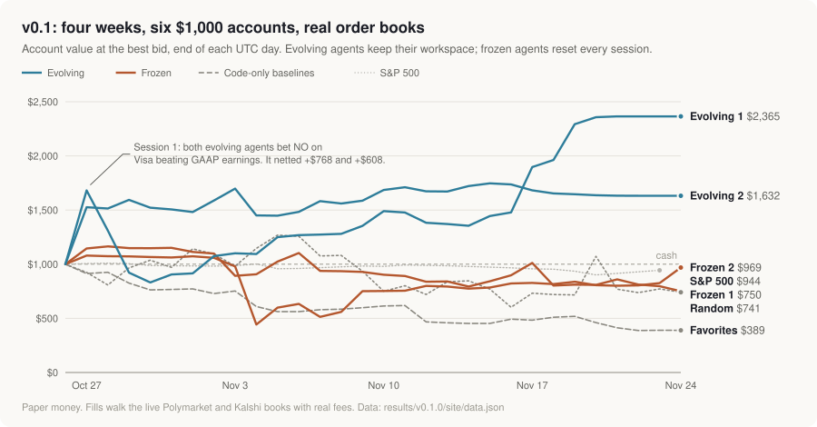
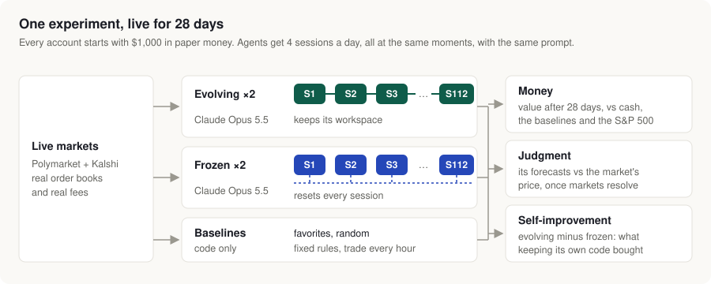
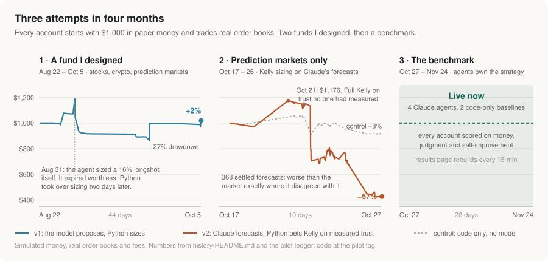
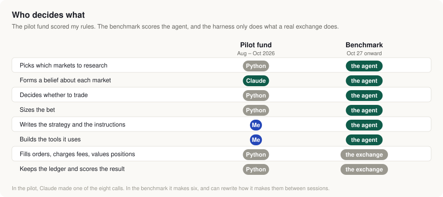
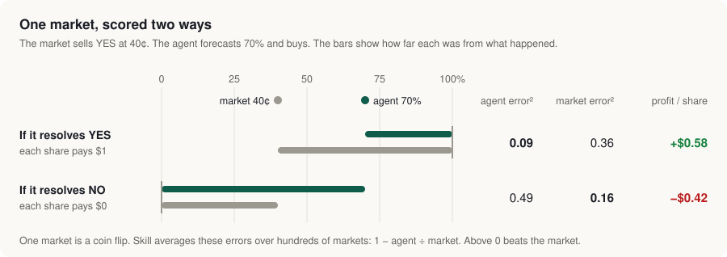
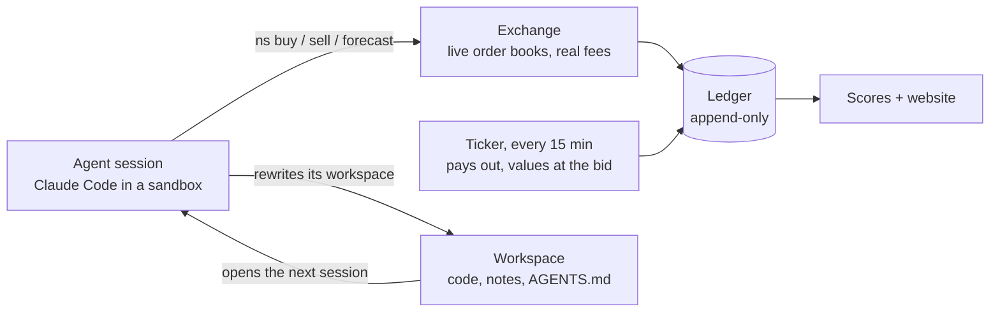

# Nightshift

**Can an AI agent make money trading prediction markets, and get better at it by rewriting its own code?**

[](https://github.com/Amadeus415/agentic_trading/actions/workflows/ci.yml)
[](results/v0.1.0)

[](LICENSE)

I gave four Claude agents $1,000 each and four weeks to trade real Polymarket and Kalshi order books. Two of them could rewrite their own code, notes and instructions between sessions. The other two started from a blank workspace every time.

The two that rewrote themselves finished at **$2,365** and **$1,632**. The two that couldn't finished at **$969** and **$750**.

Then I looked at why, and the answer is more interesting than "self-improving agents win."

<p align="center">
  
</p>

## What v0.1 found

- **The agents that kept their own code made money.** The two evolving agents returned +136% and +63%, while the two frozen agents returned −3% and −25%. Inference for all four cost $322 combined.
- **None of them out-forecast the market.** Across 453 resolved forecasts, every agent scored below the market price it traded against, from −1.7% to −8.8%. Evolving agents were no better forecasters than frozen ones.
- **One first-session insight did most of the work.** In session 1, both evolving agents spotted that Polymarket's earnings markets settle on GAAP EPS, not the adjusted number traders price. They bet against Visa and netted +$768 and +$608. Session 1 is identical for both arms, so this was a lucky first draw. Self-editing didn't earn it, but it did let the agents keep the playbook: they placed 117 more earnings bets, which lost about $35 per agent.
- **Winning most bets is not the same as making money.** The favorites baseline won 446 of 491 bets and still lost 61% to spreads and fees.

So: keeping a memory let a good idea compound, but it didn't make the model a better judge of probability. Two replicates can't tell a lucky start from a real advantage, and v0.1 says so. The full scoreboard, the pre-registered hypotheses, and every trade and session summary are in [**`results/v0.1.0`**](results/v0.1.0).

## The problem

AI agents are starting to work unattended for days at a time. Two questions decide whether that's a good idea, and most benchmarks don't test either:

1. **Can an agent decide well when nobody knows the answer yet, and mistakes cost money?** Most benchmarks grade questions whose answers already exist. Those answers leak into training data, and a wrong one costs nothing.
2. **Does an agent get better when it can rewrite its own tools and instructions?** Self-improving agents are a common claim. It's rarely tested against a control.

Prediction markets test both. Thousands of questions resolve every week, so there's nothing to memorize. The market price is a strong public forecast to beat. And with spreads and fees, an agent that's only as good as the market loses money.

## The experiment

<p align="center">
  
</p>

Each agent gets $1,000 in paper money, four sessions a day, and four weeks. It trades real order books through one command, `ns`. Between sessions it can rewrite anything in its workspace: its tools, its notes, and the `AGENTS.md` it reads at the start of the next session.

The control is the same agent with a workspace that resets every session. Both run at the same moments against the same markets, so the gap between them is what keeping its own code bought.

**v0.1 ran from October 27 to November 24, 2026:**

| Run | What it is | Final value | Forecast skill |
| --- | --- | ---: | ---: |
| `opus-evolving-1` | Claude Opus 5.5 in Claude Code. Keeps and rewrites its workspace. | $2,365 | −6.9% |
| `opus-evolving-2` | Same, second replicate. | $1,632 | −6.1% |
| `opus-frozen-2` | Same model, same prompt. Workspace resets every session. | $969 | −8.8% |
| `opus-frozen-1` | Same, second replicate. | $750 | −1.7% |
| `random` | Code only: buys random outcomes. Shows what spreads and fees cost. | $741 | — |
| `favorites` | Code only: buys 90–97¢ favorites near close. | $389 | — |

Every number comes with its 95% interval and sample size in [`results/v0.1.0`](results/v0.1.0), next to the static results site the harness built at the end of the run.

## How it got here

This repo started in July 2026 as an attempt to run an autonomous fund. Each version made the fund safer by moving one more decision out of the model and into code, until the fund was measuring me instead of the model.

<p align="center">
  
</p>

### 1. A fund I designed

The first version, Edgecraft, was a paper fund across stocks, crypto and prediction markets. July went into machinery: a backtest engine, a broker integration, risk gates, a dashboard. From August 22, a language model researched markets and proposed trades with a probability, a target and a stop. Python sized them and enforced the limits.

It ended up 2% after a 27% drawdown, and three trades decided the result. The model's confidence meant little: 46 theses said 56% on average and 20% won. Stocks lost money every way I cut the data. Prediction contracts were the only asset class that made money, and the wins came from reading settlement rules and news quickly and literally. So the next version traded nothing else.

### 2. Prediction markets only

Renamed Nightshift, the second fund traded only Polymarket and Kalshi. It logged a forecast for every market it researched, scored each one against the market price at that moment, and let a playbook bet bigger once its forecasts had earned trust. A code-only control fund set the bar.

It lost 57% in ten days. The control fund lost 8%. Across 368 settled forecasts, the model was worse than the market exactly where it disagreed with it, and the sizing rules bet full Kelly on trust that hadn't been measured yet. One thing held up: when the model said a published source had already decided a contract the market still doubted, it was right 18 times out of 18.

### 3. The benchmark

A 57% loss looks like a verdict on the model. It wasn't. Python picked the markets, decided whether to trade and sized every bet, and I wrote the playbooks. The model made one call in eight. The loss measured my rules.

<p align="center">
  
</p>

On October 26 I retired the fund and rebuilt it as a benchmark. The harness shrank to what an exchange does: fill orders against the live book, charge the venue's fees, value positions at the bid, keep the ledger, score. Everything else is the agent's: which markets to look at, what to believe, whether and how much to trade, and the code and instructions it uses to decide. A frozen twin, running at the same moments, shows whether rewriting that code helps.

Each rule in the benchmark comes from something the first two versions got wrong:

| What the pilot taught | The rule it became |
| --- | --- |
| Twenty closed trades are mostly luck. | Forecast skill against the market price is the main measure of judgment. Agents forecast far more markets than they trade. |
| The model was worse than the market exactly where it disagreed with it. | Forecasts are scored against the market's price at that moment, not against zero. |
| Python owning the sizing meant the fund tested my rules. | The agent owns strategy, sizing and research. The harness enforces only what an exchange would. |
| "Self-improving" was a design claim, never measured. | Every evolving agent has a frozen twin at the same moments. |
| Generous fills and midpoint marks flattered the numbers. | Fills walk the real book and pay real fees. Positions are valued at the bid. What the book can't fill isn't filled. |
| v1 couldn't tie results to the code that ran them. | Any change to what agents face bumps `BENCHMARK_VERSION`. Hypotheses are pre-registered. The ledger is append-only and hash-chained. |
| Fixes during a run changed what was being measured. | Live runs are never patched. Every intervention is logged with `nightshift note` and published beside the results. |

The pilot's full record is in [`history/`](history), and its code is tagged `pilot`.

## What it measures

| Question | How it's measured |
| --- | --- |
| **Does it make money?** | Account value after four weeks, against cash, the code-only baselines and the S&P 500. |
| **Does it judge better than the market?** | Every trade and forecast records the agent's probability. When the market resolves, that probability is scored against the market's price at the same moment. |
| **Does rewriting its own code help?** | Evolving minus frozen, on both numbers above. |

One market, scored both ways:

<p align="center">
  
</p>

A single market is mostly luck, so neither number means much alone. Judgment is the steadier signal: an agent forecasts many more markets than it trades, and the error is measured against the market's own price. **Skill** is 1 − (agent's average squared error ÷ market's). Above 0 means the agent saw something the market missed. Every number on the results page comes with a 95% interval from a bootstrap that resamples whole events, since markets on one event resolve together.

## The rules

An agent can:
- list markets, read their rules and live order books, and research on the web;
- buy and sell with `ns`, its only handle on money;
- write any code, notes or data in its workspace, including its `AGENTS.md`, which opens its next session.

The exchange makes trading as hard as it is for real:
- Orders fill against the live order book at the moment they arrive, with each venue's real fees.
- Positions are valued at the best bid.
- No leverage and no shorting. No single event may hold more than 25% of the account.

An agent cannot:
- read or change the exchange, the ledger, the scoring code, or another agent's files (an OS sandbox enforces this);
- trade after its four weeks end.

The full rules, metrics and pre-registered hypotheses are in [**docs/METHODOLOGY.md**](docs/METHODOLOGY.md).

## How a session works



1. Four times a day, every agent starts at the same moment in its own workspace, with the same prompt ([`agent/PROMPT.md`](agent/PROMPT.md)).
2. It researches, trades and forecasts through `ns` for up to 45 minutes.
3. The harness snapshots the workspace into a git history the agent can't reach. Evolving agents keep the workspace; frozen agents are reset.
4. Every 15 minutes a ticker with no model pays out resolved markets and values open positions.
5. Scores and the website are rebuilt from the ledgers.

Nothing in the harness calls a model. The agent's only way to move money is `ns`, which reaches the exchange through a Unix socket created for that session. The runtime is Python's standard library.

## Run it yourself

You need macOS (for Claude Code's sandbox), Python 3.11+, [uv](https://docs.astral.sh/uv/), and Claude Code signed in.

```bash
make install
uv run nightshift new my-agent --model claude-opus-5-5 --arm evolving
uv run nightshift new favorites --baseline favorites
uv run nightshift session    # one session for every live agent, in parallel
uv run nightshift tick       # pay out, value at the bid, let baselines trade
make site                    # build the results page and open it
```

State lives in `~/.nightshift`, outside the repository, because agents aren't allowed to read the repository. [`docs/OPERATIONS.md`](docs/OPERATIONS.md) covers scheduling, daily checks and publishing. `make check` runs the tests, lint and format check. Tests use fake venues and never call the network or a model.

## Where things are

| Path | What it does |
| --- | --- |
| [`agent/`](agent) | Everything an agent sees: the session prompt and its starting workspace |
| [`src/nightshift/venues.py`](src/nightshift/venues.py) | Reads Polymarket and Kalshi: markets, rules, order books, fees, outcomes |
| [`src/nightshift/exchange.py`](src/nightshift/exchange.py) | Fills orders, enforces the rules, pays out, values positions |
| [`src/nightshift/ledger.py`](src/nightshift/ledger.py) | The append-only, hash-chained record of every account |
| [`src/nightshift/ns.py`](src/nightshift/ns.py) | `ns`, the agent's command |
| [`src/nightshift/runner.py`](src/nightshift/runner.py) | Creates runs, runs sandboxed sessions, runs the ticker |
| [`src/nightshift/baselines.py`](src/nightshift/baselines.py) | The code-only baselines |
| [`src/nightshift/score.py`](src/nightshift/score.py) | Every metric and interval |
| [`src/nightshift/site.py`](src/nightshift/site.py) | The results website |
| [`docs/METHODOLOGY.md`](docs/METHODOLOGY.md) | The pre-registered spec: rules, metrics, hypotheses, threats to validity |
| [`results/`](results) | Finished runs: the scoreboard, hypotheses and full data for each benchmark version |
| [`history/`](history) | The two pilot funds and what they taught |

## Limits

- **Paper money.** Fills don't move the real market, and there are no limit orders.
- **Small samples.** Four weeks rarely separates skill from luck on returns alone. v0.1 shows why: with two replicates per arm, one first-session bet decided most of the money gap. Forecast skill is the steadier signal, and the results say when a difference could be luck.
- **One harness.** v0.1 tests Claude models in Claude Code. `ns` works for any agent that can run a shell command, so other models and harnesses are a lineup change, not a rewrite.
- **Market mix.** Open markets lean toward sports and short-dated events.

## Citation

```bibtex
@misc{nightshift2026,
  title  = {Nightshift: Can AI Agents Make Money Trading Prediction Markets and Improve by Rewriting Their Own Code?},
  author = {Colenbrander, Amadeus},
  year   = {2026},
  url    = {https://github.com/Amadeus415/agentic_trading}
}
```

[Apache 2.0](LICENSE) · [Security](SECURITY.md) · [Contributing](CONTRIBUTING.md)
