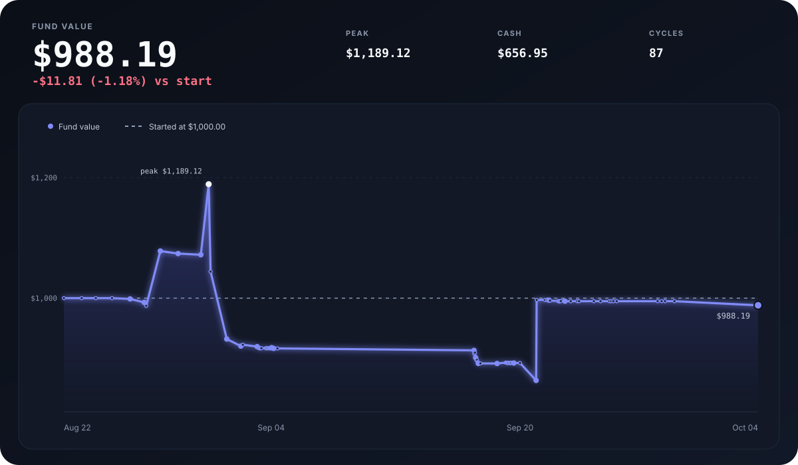

# Edgecraft

**Can an LLM earn an after-cost edge by reading prediction-market rules and public news?**

Edgecraft tests that question with simulated money. Codex researches; Python owns public quotes, fees, position sizes, exits, and accounting. There is no real-order, broker, wallet, or transfer path.

## Why prediction markets?

The first multi-asset experiment ended its archived sample at **$1,020.41 from $1,000**, across **96 cycles and 22 closed paper trades**. Stocks lost **$41.28** over 12 trades; crypto gained **$17.52** over 4; prediction contracts gained **$44.16** over 6. These small, uneven samples justify a research direction, not a claim of profitable LLM alpha. The largest prediction loss was a crypto-price bet in disguise.



[The complete v1 evidence](history/v1-multi-asset/README.md) includes the results data, trades, original playbooks, and lessons. The original code is tagged `v1-multi-asset`. Previous charts, Git history, private packets, and ledger rows are preserved.

## The new experiment

`edgecraft-predictions` starts with its **own $1,000 paper bankroll and no inherited results**, alongside v1 in the same append-only database. Its three playbooks target plausible strengths of language-model research:

- **Resolution reading:** compare exact settlement rules with authoritative public facts.
- **Consistency:** inspect equivalent events and complementary outcomes; code flags price gaps, research checks what the contracts actually mean.
- **Long-tail news:** connect primary releases to less-followed event markets and quantify the probability update.

The scanner reads Polymarket and Kalshi, filters for spread, displayed depth, and time to resolution, and ranks a bounded shortlist for research. Its rank measures research usability, not expected profit. Stock/crypto price bets are excluded until a validated reference model exists.

Python buys YES or NO with cash, uses half Kelly with a 25% position ceiling and a 35% shared-driver ceiling, and fits orders to actual book depth and risk limits. Horizons can extend through resolution, up to one year. These are ceilings, never required exposure. Unknown fees, missing required evidence, or unavailable position marks stop the run.

Polymarket marks use the best bid/ask midpoint; simulated fills consume the appropriate book side. Fees use recorded market parameters, including Kalshi's quadratic taker fee and series multiplier. [Design](docs/DESIGN.md) documents the execution assumptions and limitations.

## Track whether changes help

Every new cycle records the exact checked-out Git commit, including a dirty flag. [CHANGELOG.md](CHANGELOG.md) records why trading behavior changed and what to measure.

```bash
make fund-lineage      # NAV, fills, and fees by revision; old revisions are inferred
make fund-report-file  # P&L, forecast scores, playbooks, and lineage
```

Forecast scoring compares the first funded probability per contract with the entry market probability using **Brier score**. Positive Brier improvement means the model forecast was closer to the official outcome. **Sampled CLV** compares the entry market price with the last recorded pre-settlement mark. Unresolved contracts and missing closing observations remain unscored. Refreshing a belief cannot multiply the sample. Reports include cuts by playbook and revision; correlation, selection, and small samples still limit conclusions.

The read-only dashboard switches between funds and shows revision performance and forecast scores. A report from another fund is never substituted. SPY comparisons are price-only and depend on available aligned observations. Code lineage establishes which code ran, not causation.

## Run locally

Python 3.11–3.14, [uv](https://docs.astral.sh/uv/), and Node.js 22+ for the dashboard:

```bash
make install
make validate
make fund-init
make fund-context
make fund-scan
make fund-report-file
cd dashboard && npm ci && npm run dev
```

Open [localhost:3000](http://localhost:3000). Defaults use `examples/fund.mandate.predictions.json` and the existing `state/edgecraft-aggressive.db` database filename. Keeping that filename retains one ledger; the active fund ID is different. Never operate on a development copy as if it were authoritative runtime state.

[Operations](docs/OPERATIONS.md) describes the explicit v1 retirement and deployment steps. [Scheduled trading](docs/CODEX_SCHEDULED_TASK.md) defines one packet, one apply, verify, and stop on failure. [Evolution](docs/EVOLUTION.md) governs separate forward experiments. Source changes alone do not deploy the runtime or resume schedules.

A profitable trading edge remains unproven. Public-book fills are simulations; actual execution, settlement delays, and dense closing prices are not established by unit tests. Source is public; private ledgers, caches, and credentials stay out of Git. [Apache 2.0](LICENSE) · [Security](SECURITY.md).
