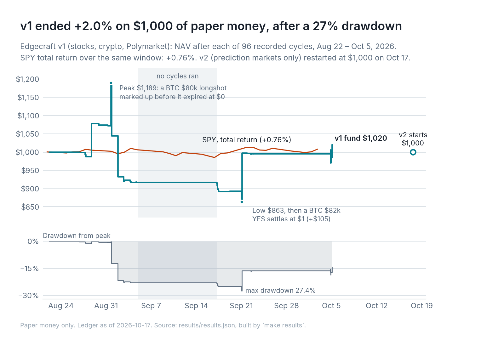
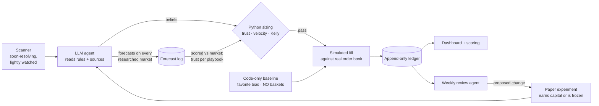
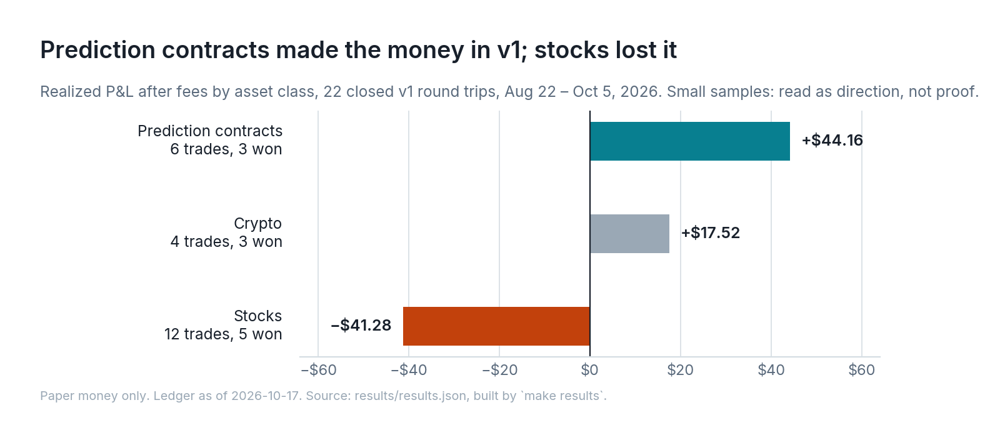
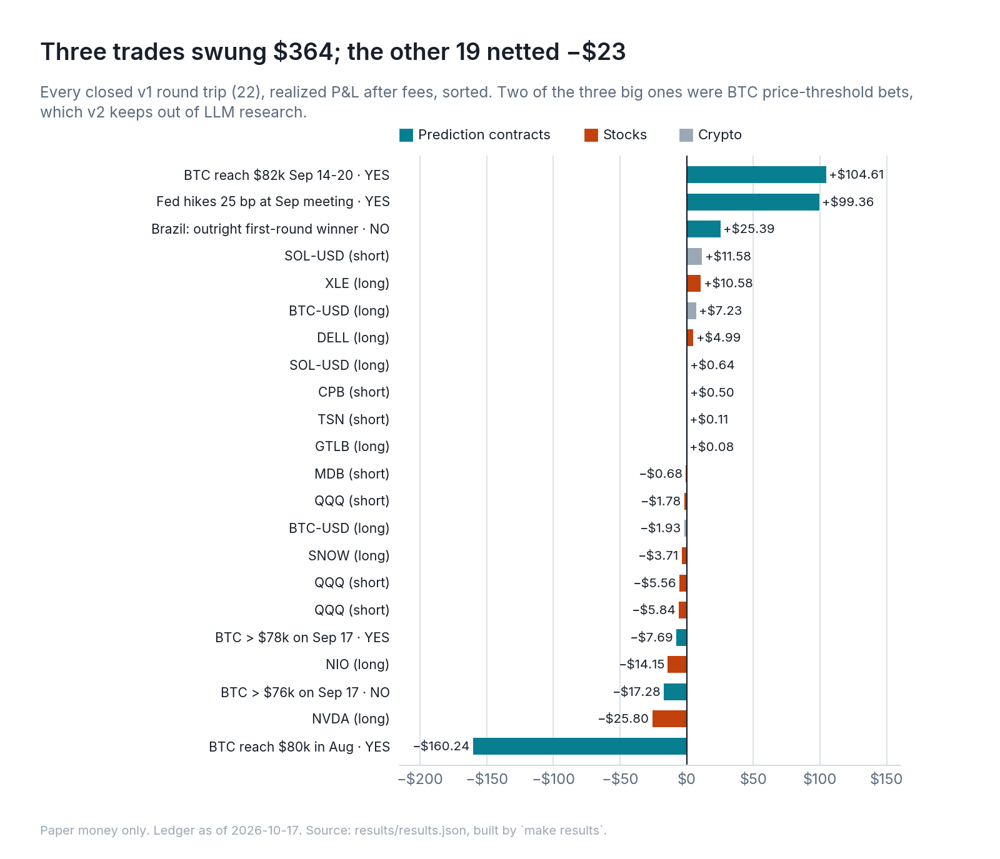
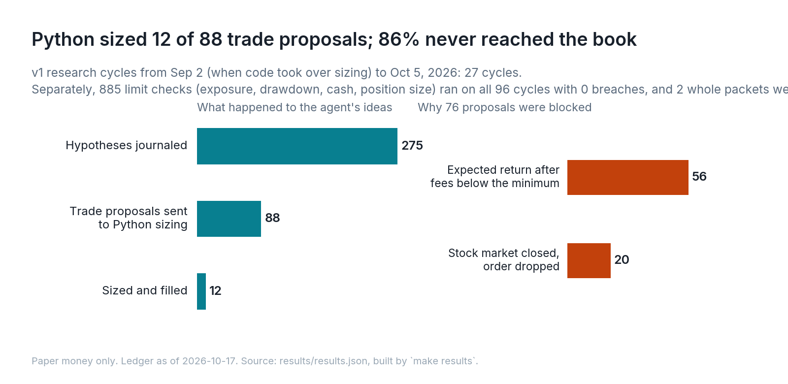
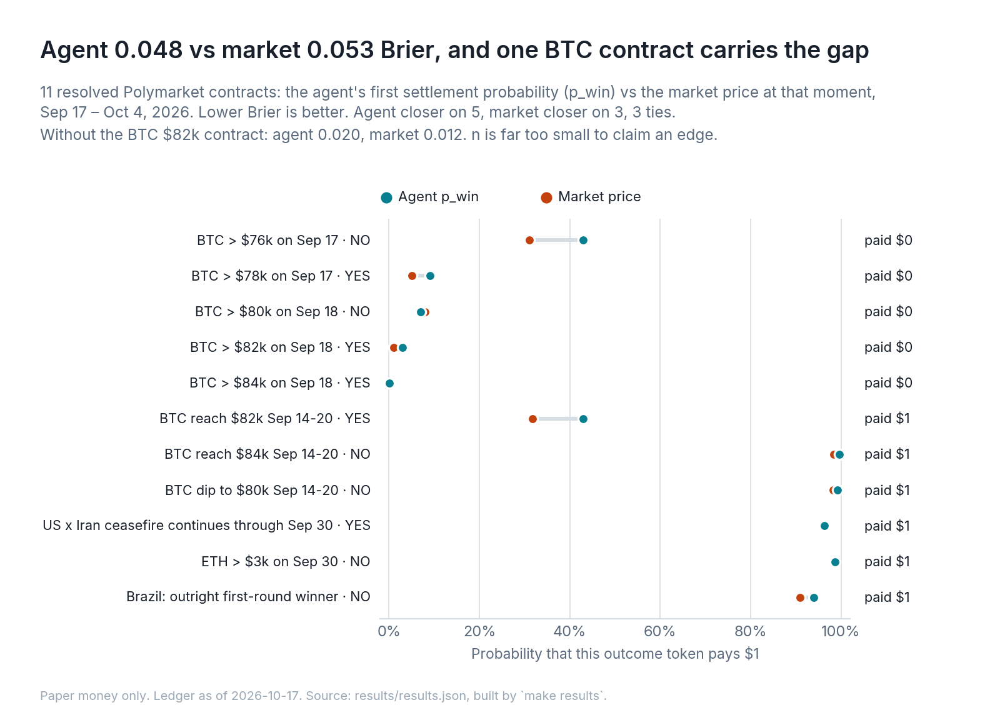
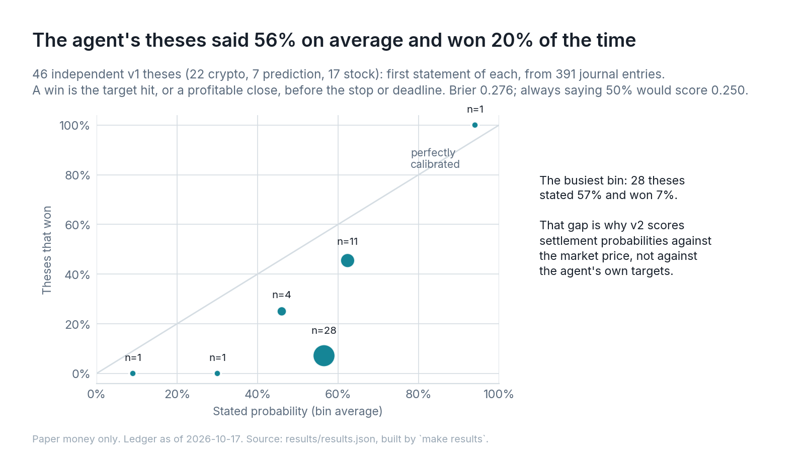
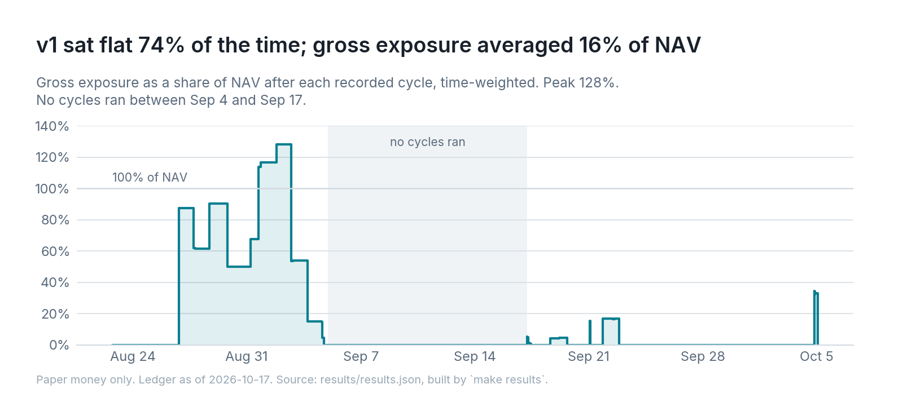
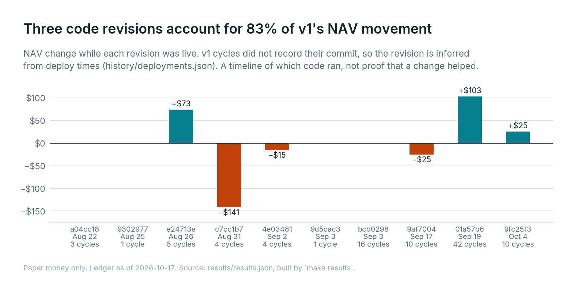
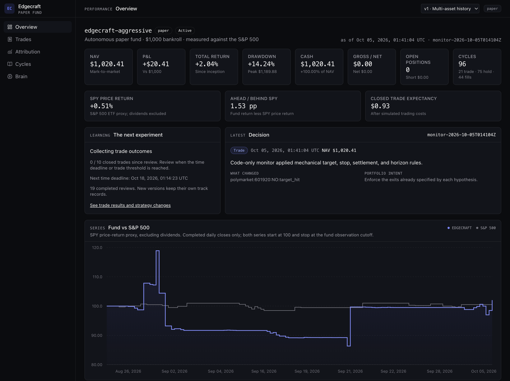

# Nightshift

A prediction-market paper fund that agents run and improve every day. An LLM does the research; deterministic Python holds the money.

[](https://github.com/Amadeus415/agentic_trading/actions/workflows/ci.yml)


[](LICENSE)

I built this to learn how to run a codebase that keeps improving while non-deterministic agents work on it every day, and to see whether it could make money along the way. Research agents trade Polymarket and Kalshi contracts with a simulated $1,000 bankroll several times a day. Once a week a review agent reads the results and proposes changes, and each change has to earn its capital in a small paper experiment. There is no broker, wallet, or real-order path, and there won't be one.

Nightshift was called Edgecraft until October 2026. The Python package and CLI still use `edgecraft`.



## Results so far

As of October 17, 2026. All money is simulated. Every number comes from [`results/results.json`](results/results.json), which `make results` rebuilds.

| | v1: multi-asset (retired) | v2: prediction markets |
| --- | --- | --- |
| Dates | Aug 22 – Oct 5, 2026 | started Oct 17, 2026 |
| Paper NAV | $1,000 → $1,020.41 (+2.04%) | $1,000, no completed cycles yet |
| SPY total return, same window | +0.76% | pending |
| Max drawdown | 27.4% | pending |
| Cycles | 96 (41 LLM research, 55 code-only monitor) | 0 |
| Closed round trips | 22, 11 won, $4.71 in fees | 0 |
| Trade proposals Python blocked | 76 of 88 (86%) | pending |
| Risk-limit breaches | 0 in 885 checks | pending |
| Brier, agent vs market price | 0.048 vs 0.053 on 11 resolved contracts | pending |
| Stated vs realized win rate | 56% vs 20% on 46 theses | pending |

The short version: v1 made 2% and fell 27% on the way. Three trades decided the result. The agent's stated confidence meant little, and code rejected most of what it proposed, which is the design working. Prediction contracts were v1's best asset class, so v2 trades nothing else.

## How it works



1. Scan. The scanner lists both venues across four horizon windows and ranks contracts that resolve soon (capital turns over) and that few traders watch (prices adjust slowly). Liquidity only has to be enough to fill.
2. Research and forecast. The agent reads exact settlement rules and primary sources, then writes a YES probability for every market it researched, traded or not.
3. Score. Code stamps each forecast with the market price at that moment and scores it when the market settles (or, earlier, by whether the price drifted toward it). Each playbook earns a trust number: how much of its disagreement with the market has proven right.
4. Size. Python bets on `market + trust × (belief − market)`, drops edges that cannot clear a 30% annualized hurdle, funds the fastest edges first, and applies full Kelly to that shrunk belief, a 25% position cap, a 50% shared-risk cap, and real venue fees.
5. Control. A second fund with no model trades two structural edges: favorites that settle more often than their price implies, and mutually exclusive outcomes whose YES bids sum above $1. If the LLM fund can't beat it, the LLM is costing money.
6. Record. Every cycle and forecast lands in one append-only, hash-chained ledger, tagged with the exact Git commit that ran it.
7. Improve. A weekly review agent proposes the smallest change the evidence supports: a prompt edit, a rule tweak, or a new playbook. Each one runs as its own paper experiment that forecasts the same markets as its parent. After 30 scored forecasts, measured trust promotes it or freezes it; 10 losing closed trades also freeze it. Details in [`docs/EVOLUTION.md`](docs/EVOLUTION.md).

Research runs on a schedule (four sessions a day as Claude Code scheduled tasks). A code-only monitor marks open positions every five minutes, enforces stops, targets, and settlement, scores forecasts, and runs the control fund without calling a model.

## Reproduce the report

```bash
make install   # Python dependencies, including matplotlib
make results   # rebuild results/results.json and results/charts/*.png, offline
```

`make results` reads two committed files in [`results/data/`](results/data):

- `ledger-extract.json`: numbers pulled from the private ledger. NAV after every cycle, fills, every journaled probability with the market price at that moment, and each sizing and risk-gate decision. No research text, evidence, or source URLs.
- `public-data.json`: Polymarket resolutions for every contract the agent forecast, and SPY daily closes for the benchmark. Both public, fetched October 17, 2026.

To refresh them from a ledger, run `make results-data RESULTS_LEDGER=path/to/edgecraft-aggressive.db`. The extract copies the database through SQLite's backup API on a read-only connection, so it is safe to point at a ledger that a scheduled run is writing to. `results.json` records the ledger snapshot time, the code commit, and the machine it ran on (Apple M4 Pro, macOS 26, Python 3.14). The metric code is in [`src/edgecraft/results.py`](src/edgecraft/results.py), with tests in [`tests/test_results.py`](tests/test_results.py).

## Results in detail

### Where the money came from





Stocks were more than half the trades and all of the losses by class. The two BTC threshold contracts at the ends of the chart were crypto price bets dressed as prediction contracts. The Fed and Brazil trades are closer to what v2 is built for: read the rules and the news, then price the contract.

### What the gates did



From September 2, the agent stopped choosing quantities. It sent beliefs (probability, target, stop) and Python decided whether a trade cleared fees and by how much. 56 proposals had an expected return after fees below the minimum, and 20 were stock orders while the market was closed. Separately, 885 limit checks (exposure, turnover, drawdown, cash reserve, position weight) ran across all 96 cycles without a breach, and two whole packets were refused: one priced a stock from a quote more than a day old, and one reused a cycle key with a different request. The monitor also logged 52 failed mark fetches instead of inventing a price.

### Forecasts vs the market



This is the comparison I care most about, and the sample is tiny. For each Polymarket contract, I take the agent's first settlement probability and the market price at the same moment, then score both against the official resolution. The agent edges the market 0.048 to 0.053, but one contract (BTC reaching $82k in a weekly window) accounts for all of it. Drop it and the market wins 0.012 to 0.020. Early v1 journals used a `confidence` field that meant "will the price reach my target," not "will this settle YES," so those forecasts are left out.



Across all asset classes, each thesis had a target, a stop, and a stated chance of hitting the target first. Counting each thesis once (the journal restates open theses every cycle, and the monitor copies them hourly), the 46 theses said 56% on average and won 20%. That gap is why v2 scores settlement probabilities against the market price instead of the agent's own targets.

### Exposure



v1 held cash most of the time. That also means the SPY comparison in the table is not risk-matched: SPY was fully invested, the fund averaged 16% gross exposure.

### Which code ran



v1 cycles did not record their commit, so this view is inferred from deploy times in [`history/deployments.json`](history/deployments.json). v2 records `source_revision` on every cycle, and `make fund-lineage` prints the same table from the ledger.

## Design choices

| Choice | Why |
| --- | --- |
| Learn from forecasts, not trades | Ten closed trades are mostly luck. Hundreds of forecasts scored against the market price at that moment measure skill in days and decide which playbooks get capital. Only the first forecast per contract counts, so restating a belief can't inflate the sample. |
| Trust shrinks every belief | An LLM's confidence is not an edge. Sizing only keeps the share of its disagreement with the market that has proven right; zero trust means zero trades. |
| Velocity over size | A 1¢ edge that settles tomorrow compounds faster than a 10¢ edge that settles next year. Rank and sizing both run on return per unit of time. |
| A code-only control fund | The bar the LLM must clear. It also fits the favorite-longshot curve from every scanned market's settlement. |
| The agent proposes; code decides | The LLM never touches cash, sizing, or accounting. It cannot invent a fill, pick its own size, or add capital. A model that is wrong 80% of the time is survivable if it can't spend. |
| Fail closed | Unknown fees, stale quotes, missing evidence, or missing marks stop the run instead of guessing. |
| Every cycle is pinned to a commit | `make fund-lineage` shows NAV, fills, and fees per code revision, so strategy changes are measured, not remembered. |
| History is never rewritten | Each era is its own fund in the same ledger. v2 started at $1,000 and inherits nothing from v1. |
| Published numbers come from a script | The README tables and charts are generated from committed data, so they can be checked and rebuilt. |

## What I learned

- The agent's conviction was close to noise. In the busiest bucket, 28 theses said 57% and two of them won.
- The worst loss happened before code owned sizing. On August 31 the agent bought 1,000 YES shares of "BTC reaches $80k in August" at $0.16 on its own, $160 of a $1,072 book, and it expired worthless. Python took over sizing two days later.
- Most of the agent's ideas died in code, which is the point of the split. The 10 trades the agent sized itself lost $84.62. The 12 that Python sized made $105.03, but $104.61 of that is one BTC contract, so apart from it they were small and flat.
- The forecast edge over the market, if it exists, is one contract deep. Nine of the eleven scored contracts were BTC or ETH price thresholds, which v2 now keeps out of LLM research.
- Recording the commit on every cycle is cheap and I should have done it from day one. Half of the lineage chart is inference.

## Limitations

- Paper money. Fills are simulated against public order books; queue position, settlement delays, and slippage beyond displayed depth are not modeled.
- Small samples: 22 round trips, 11 resolved forecasts, 46 theses. Nothing here proves an edge in either direction.
- NAV is only known at recorded cycles. The drawdown low ($863) includes marking a fresh position at the midpoint right after buying it at the ask; before that entry the drawdown was 25.0%.
- No cycles ran between September 4 and September 17.
- Polymarket outcomes were fetched after the fact from the public API and taken as final.
- v2 has no completed cycles yet. Nothing on this page measures v2.
- A v2 edge is unproven: the favorite-bias curve starts from a prior, and trust starts at 0.60 until forecasts are scored.

## Run the fund

Requires Python 3.11–3.14, [uv](https://docs.astral.sh/uv/), and Node.js 22+ for the dashboard.

```bash
make install           # dependencies
make validate          # tests + lint
make fund-init         # create the $1,000 paper fund
make fund-scan         # rank markets worth researching
make fund-baseline     # one pass of the code-only control fund
make fund-report-file  # P&L, forecast trust, lineage
cd dashboard && npm ci && npm run dev   # http://localhost:3000
```

The read-only dashboard shows both eras from the same ledger:



## Repo map

| Path | What's there |
| --- | --- |
| [`src/edgecraft/`](src/edgecraft) | Scanner, forecast log, sizing, baseline fund, paper fund, scoring, lineage, results |
| [`results/`](results) | Measured results, charts, and the data that rebuilds them |
| [`playbooks/`](playbooks) | The three v2 research playbooks and their prompts |
| [`dashboard/`](dashboard) | Read-only Next.js + SQLite dashboard |
| [`docs/`](docs) | [Design](docs/DESIGN.md), [accounting contract](docs/FUND_ACCOUNTING.md), [operations](docs/OPERATIONS.md), [how the fund learns](docs/EVOLUTION.md), [scheduled runs](docs/SCHEDULED_TASKS.md) |
| [`history/`](history) | Archived eras, results, and deployment lineage |
| [`CHANGELOG.md`](CHANGELOG.md) | Why each trading change was made and what it should move |

v2 runs three research playbooks, each aimed at something language models may be good at: resolution reading (compare exact settlement rules with authoritative facts), consistency (find equivalent contracts whose prices disagree, then check what they really mean), and long-tail news (connect primary-source releases to less-watched markets). The full v1 record is in [history/v1-multi-asset](history/v1-multi-asset/README.md), and its code is tagged `v1-multi-asset`.

## License

[Apache 2.0](LICENSE) · [Security](SECURITY.md) · [Contributing](CONTRIBUTING.md)
