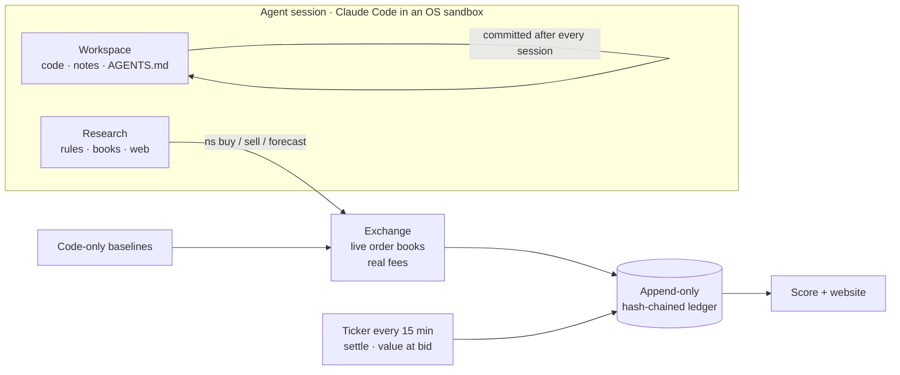

# Nightshift

**Can an AI agent make money trading prediction markets, and get better at it by rewriting its own code?**

Nightshift is a live benchmark. Each agent gets a simulated $1,000 account on Polymarket and Kalshi and four sessions a day for 28 days. Every order fills against the venue's live order book with its real fees. Between sessions, an agent can rewrite everything in its own workspace: tools, notes, data, and the instructions that open its next session. Identical agents that start fresh every session are the control. The gap between the two arms is the self-improvement result.

[](https://github.com/Amadeus415/agentic_trading/actions/workflows/ci.yml)

[](LICENSE)

## How it works



1. **Session.** Four times a day, every live agent runs at once: one headless Claude Code session per agent, inside its own git workspace. The prompt is the same for all of them ([`agent/PROMPT.md`](agent/PROMPT.md)). The workspace's `AGENTS.md` is appended to the system prompt.
2. **Trade.** The agent's only handle on money is `ns`: list markets, read rules and order books, buy, sell, forecast. Buys walk the asks, sells walk the bids, whole shares only, with venue fees. No position may cost more than 25% of the account.
3. **Forecast.** Every buy states a probability that YES wins. Agents also forecast markets they research but don't trade. Each forecast is stamped with the market's own price at that moment.
4. **Settle.** A model-free ticker pays out resolved markets and values open positions at the best bid.
5. **Rewrite.** After each session the harness commits the workspace. An *evolving* agent keeps it for the whole run; a *frozen* agent is reset to the seed every session.
6. **Score.** The scores are return, max drawdown, after-fee edge per dollar, forecast skill against the market price, inference cost and lines of self-modification. Intervals come from resampling whole events, because same-event markets resolve together.

The rules, metrics, pre-registered hypotheses and threats to validity are in [**docs/METHODOLOGY.md**](docs/METHODOLOGY.md).

## Design choices

| Choice | Why |
| --- | --- |
| Live markets only | Replays leak outcomes the model may have trained on. A live window can't. |
| The agent owns all strategy | The harness enforces only cash, real fills, fees and a 25% position cap. Sizing, research method and risk are the agent's, so the score is the agent's. |
| Evolving vs frozen, at the same moments | A before/after comparison mixes self-improvement with a change in the market. Running both arms together cancels shared market noise. |
| Forecast skill against the market | P&L from a few dozen bets is mostly luck. Forecasts on many markets, scored against the market price at that moment, measure judgment with far more data. |
| Fills that favor the market over the agent | Fills walk the real book and pay real fees, and positions are valued at the bid. Generous fills are the most common flaw in trading benchmarks. |
| The sandbox is the trust boundary | The agent can write only its workspace and can reach the exchange only through its own socket. Ledgers are append-only and hash-chained. |
| Code-only baselines on the same exchange | They show what a strategy with no model earns, and what spread and fees cost. |
| Cost is a first-class number | With $1,000 at stake, inference can cost more than the trading earns. |
| Every intervention is logged | `nightshift note` publishes each human restart, fix or pause next to the results. |

## Run it

Requires macOS (for Claude Code's sandbox), Python 3.11+, [uv](https://docs.astral.sh/uv/), and Claude Code signed in.

```bash
make install
uv run nightshift new opus-evolving-1 --model claude-opus-5-5 --arm evolving
uv run nightshift new opus-frozen-1   --model claude-opus-5-5 --arm frozen
uv run nightshift new favorites --baseline favorites
uv run nightshift new random    --baseline random
uv run nightshift session          # one session for every live agent, in parallel
uv run nightshift tick             # settle, value at the bid, trade baselines
make site                          # score and build the site, then open it
./scripts/install_schedule.sh      # run sessions and ticks on a schedule with launchd
```

State lives in `$NIGHTSHIFT_HOME` (default `./var`, git-ignored):
- `runs/<id>/` holds the ledger, session records and transcripts.
- `workspaces/<id>/` holds the agent's own git repository.
- `site/` holds the built website and its `data.json`.

[`docs/OPERATIONS.md`](docs/OPERATIONS.md) covers the v1 lineup, the daily routine and publishing.

## Repo map

| Path | What's there |
| --- | --- |
| [`src/nightshift/venues.py`](src/nightshift/venues.py) | Read-only Polymarket and Kalshi data: listings, rules, order books, fees, resolutions |
| [`src/nightshift/exchange.py`](src/nightshift/exchange.py) | Fills, the position cap, settlement, valuation, and the socket an agent trades through |
| [`src/nightshift/ledger.py`](src/nightshift/ledger.py) | The append-only, hash-chained event log; account state is a fold over it |
| [`src/nightshift/ns.py`](src/nightshift/ns.py) | `ns`, the agent's command-line client |
| [`src/nightshift/runner.py`](src/nightshift/runner.py) | Runs, sandboxed sessions, workspace commits, the ticker |
| [`src/nightshift/baselines.py`](src/nightshift/baselines.py) | Code-only favorites and random accounts |
| [`src/nightshift/score.py`](src/nightshift/score.py) | Metrics and cluster-bootstrap intervals |
| [`src/nightshift/site.py`](src/nightshift/site.py) | The static website |
| [`agent/`](agent) | What every agent sees: the session prompt and the seed workspace |
| [`docs/METHODOLOGY.md`](docs/METHODOLOGY.md) | The benchmark specification |
| [`history/`](history) | The pilot this benchmark grew out of |

## Limitations

- **Paper money.** Fills take displayed depth without moving the market, and there are no limit orders.
- **Small samples.** A 28-day window rarely has enough resolved bets to tell return differences from luck; forecast skill is the steadier signal.
- **One harness.** Version 0.1 runs Claude models in Claude Code only. The exchange works with any agent that can run a shell command, so other harnesses are an extension, not a rewrite.
- **Market mix.** Open markets lean toward sports and short-dated events.

## Where this came from

From August to October 2026 the same idea ran as a human-designed fund: Python owned sizing and risk, and Claude proposed trades. It lost 57% of its paper bankroll in its final version. The main lesson: the harness designer's strategy was being tested, not the agent's. [`history/`](history) has the record, and the code is tagged `pilot`.

## Citation

```bibtex
@misc{nightshift2026,
  title  = {Nightshift: Can AI Agents Make Money Trading Prediction Markets and Improve by Rewriting Their Own Code?},
  author = {Colenbrander, Amadeus},
  year   = {2026},
  url    = {https://github.com/Amadeus415/agentic_trading}
}
```

[Apache 2.0](LICENSE) · [Security](SECURITY.md) · [Contributing](CONTRIBUTING.md)
