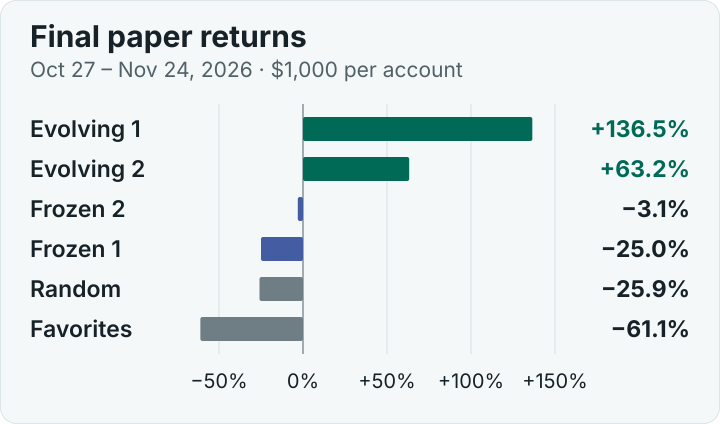

# Nightshift

**Can an AI agent make money in prediction markets? Does keeping and rewriting its own code help?**

I gave four Claude agents $1,000 each in paper money and four weeks to trade live Polymarket and Kalshi order books. Two agents kept their code, notes and instructions between sessions. Two got a fresh copy of the starting workspace each time.

## What happened in v0.1

Both agents that kept their workspaces made money. They finished up **136.5%** and **63.2%**. Both agents whose workspaces reset lost money.



**One bet explains most of the gap.** Both evolving agents bet against Visa in their first session after spotting that the contract settled on reported GAAP earnings per share. The bet earned them $768 and $608. All four agents started that session from the same seed workspace, so the win came before workspace persistence could help. With two agents per arm, the effect of persistence on returns remains uncertain.

All four agents had negative forecast skill scores against the market. The pooled forecast skill gap between evolving and frozen agents was **−2.3 percentage points** across 453 scored forecasts, with a 95% interval from **−14.7 to +9.3**. Whether retaining a workspace improved forecasting remains open.

[Full v0.1 report and data](https://github.com/Amadeus415/agentic_trading/tree/815083b5d639821216bd325b2921c348ea23772b/results/v0.1.0)

## How the experiment works

| Group | Accounts | How it works |
| --- | ---: | --- |
| Evolving | 2 | The agent keeps its workspace and can build on its edits in the next session. |
| Frozen | 2 | The agent starts each session from the seed workspace. |
| Baselines | 2 | One script buys favorites priced at 90–97¢. The other buys randomly selected outcomes. |

The four Claude Opus 5.5 agents share a model, task and schedule. Each keeps its account, trade history and forecasts. The agents choose what to research, what probability to assign, and whether and how much to trade. They use `ns` to read markets, record forecasts and place simulated orders from a sandboxed workspace.

The harness fills against displayed order-book depth, charges venue fees and values open positions at the bid. It settles resolved positions and records every account event in an append-only ledger. [Pre-registered methodology](docs/METHODOLOGY.md) · [Session prompt](agent/PROMPT.md)

**Return measures the account. Forecast skill measures judgment.** A profitable account can still make poor forecasts. For each eligible resolved market, the benchmark compares the agent's first probability with the market's YES midpoint at that moment. A positive skill score means the agent had lower average squared error than the market. The evolving–frozen comparison tests whether carrying a workspace helps on either measure.

I started with a paper fund where my Python rules picked the trades and sized the bets. The prediction-market pilot lost 57%. That result made me ask a better experimental question: what happens when the agent owns those decisions? [Pilot history](history/)

## Run it locally

Use macOS, Python 3.11+, [uv](https://docs.astral.sh/uv/), and a signed-in Claude Code installation.

```bash
make install
uv run nightshift new my-agent --model claude-opus-5-5 --arm evolving
uv run nightshift new favorites --baseline favorites
uv run nightshift session
make tick
```

`make tick` settles markets, updates account values and builds the HTML report at `~/.nightshift/site/index.html` by default. Run `make check` for tests, lint and formatting. [Scheduling and publishing](docs/OPERATIONS.md)

[Apache 2.0](LICENSE) · [Contributing](CONTRIBUTING.md) · [Security](SECURITY.md)
