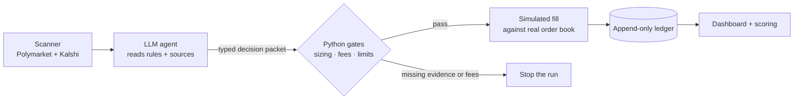

# Edgecraft

**An autonomous prediction-market fund where an LLM does the research and deterministic code holds the money.**

[](https://github.com/Amadeus415/agentic_trading/actions/workflows/ci.yml)


[](LICENSE)

Edgecraft asks one question: **can an LLM earn an after-cost edge by reading prediction-market rules and public news?** It trades Polymarket and Kalshi contracts with a simulated $1,000 bankroll. No broker, wallet, or real-order path exists.


## How it works



1. **Scan.** The scanner filters live markets by spread, book depth, and time to resolution, then ranks a short list for research.
2. **Research.** The agent reads exact settlement rules and primary sources and proposes a probability for each contract it researches.
3. **Gate.** Python owns everything with money in it: half-Kelly sizing, a 25% position cap, a 35% cap on shared risk drivers, venue fee models (including Kalshi's quadratic taker fee), and exits.
4. **Fill.** Orders consume the real public order book. Marks use the bid/ask midpoint.
5. **Record.** Every cycle lands in an append-only ledger, tagged with the exact Git commit that ran it.

## Design choices

| Choice | Why |
| --- | --- |
| **The agent proposes; code decides** | The LLM never touches cash, sizing, or accounting. It cannot invent a fill or inject capital. |
| **Fail closed** | Unknown fees, missing evidence, or missing marks stop the run instead of guessing. |
| **Every cycle is pinned to a commit** | `make fund-lineage` shows NAV, fills, and fees per code revision, so strategy changes are measured, not remembered. |
| **Honest scoring** | Forecasts are scored against resolved outcomes with **Brier score** and **closing-line value**, not just P&L. Refreshing a belief can't inflate the sample. |
| **History is never rewritten** | Each strategy era is its own fund in the same ledger. A new version starts at $1,000 and inherits nothing. |

## Results

| Era | Dates | Result |
| --- | --- | --- |
| **v1: multi-asset** | Aug 22 – Oct 5, 2026 | **$1,000 → $1,020.41** over 96 cycles and 22 closed trades. Ahead of SPY by 1.5 pp. |
| **v2: prediction markets** | Started Oct 17, 2026 | Fresh $1,000, building its own track record |

v1 traded stocks, crypto, and prediction contracts. Stocks lost $41.28 over 12 trades; crypto gained $17.52 over 4; prediction contracts gained **$44.16 over 6**. The sample is far too small to prove an edge, but it pointed the next experiment at prediction markets. The full record is in [history/v1-multi-asset](history/v1-multi-asset/README.md), and the original code is tagged `v1-multi-asset`.

v2 runs three research playbooks, each aimed at something language models may actually be good at:

- **Resolution reading:** compare exact settlement rules with authoritative public facts.
- **Consistency:** find equivalent or complementary contracts whose prices disagree, then check what the contracts really mean.
- **Long-tail news:** connect primary-source releases to less-watched markets and quantify the update.

## Run it

Requires Python 3.11–3.14, [uv](https://docs.astral.sh/uv/), and Node.js 22+ for the dashboard.

```bash
make install           # dependencies
make validate          # tests + lint
make fund-init         # create the $1,000 paper fund
make fund-scan         # rank markets worth researching
make fund-report-file  # P&L, forecast scores, lineage
cd dashboard && npm ci && npm run dev   # http://localhost:3000
```

## Repo map

| Path | What's there |
| --- | --- |
| [`src/edgecraft/`](src/edgecraft) | Scanner, sizing, policy gates, paper fund, scoring, lineage |
| [`playbooks/`](playbooks) | The three v2 research playbooks and their prompts |
| [`dashboard/`](dashboard) | Read-only Next.js + SQLite dashboard |
| [`docs/`](docs) | [Design](docs/DESIGN.md), [accounting contract](docs/FUND_ACCOUNTING.md), [operations](docs/OPERATIONS.md), [how the fund learns](docs/EVOLUTION.md), [scheduled runs](docs/CODEX_SCHEDULED_TASK.md) |
| [`history/`](history) | Archived eras, results, and deployment lineage |
| [`CHANGELOG.md`](CHANGELOG.md) | Why each trading change was made and what it should move |

## Limits

A profitable edge is **unproven**. Fills are simulated against public books; real execution, settlement delays, and slippage beyond displayed depth are not modeled. Lineage shows which code ran, not that a change caused a result. Private ledgers, caches, and credentials stay out of Git.

[Apache 2.0](LICENSE) · [Security](SECURITY.md) · [Contributing](CONTRIBUTING.md)
