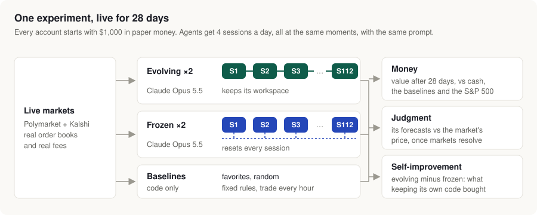
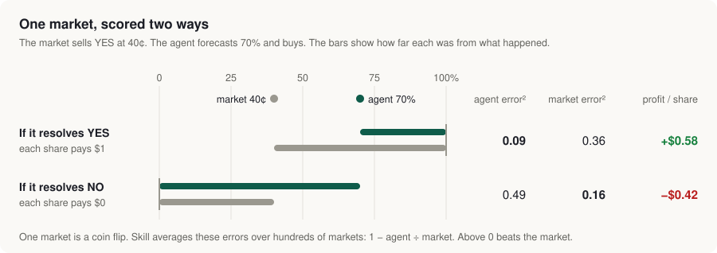
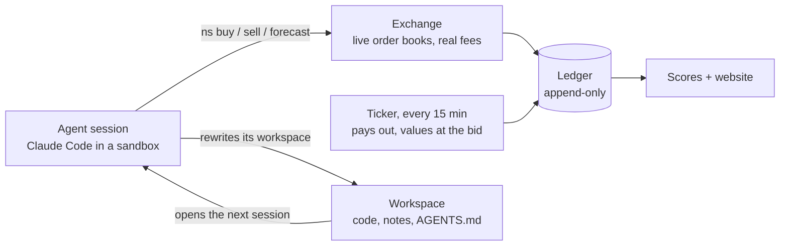

# Nightshift

**Can an AI agent make money trading prediction markets, and get better at it by rewriting its own code?**

[](https://github.com/Amadeus415/agentic_trading/actions/workflows/ci.yml)

[](LICENSE)

## The problem

AI agents are starting to work unattended for days at a time. Two questions decide whether that's a good idea, and today's benchmarks rarely test either one:

1. **Can an agent decide well when nobody knows the answer yet, and mistakes cost money?** Most benchmarks grade questions whose answers already exist: a test passes or a fact is right. Those answers can leak into training data, and a wrong one costs nothing.
2. **Does an agent get better when it can rewrite its own tools and instructions?** Self-improving agents are a common claim, but the claim is rarely tested against a control: the same agent, at the same moments, that can't keep its changes.

Prediction markets test both. Thousands of questions resolve every week, so there is nothing to memorize. The market price is a strong public forecast to beat. And spreads and fees make an agent that is merely as good as the market lose money.

## The experiment

<p align="center">
  
</p>

Each agent gets $1,000 in paper money, four work sessions a day, and four weeks. It trades real Polymarket and Kalshi order books through one command, `ns`. Between sessions it can rewrite anything in its own workspace: its tools, its notes, and the instructions it reads at the start of the next session.

The control is an identical agent whose workspace resets every session. Both run at the same moments against the same markets, so any gap between them is what keeping its own code bought.

**v1 is live from October 27 to November 24, 2026:**

| Run | What it is |
| --- | --- |
| `opus-evolving-1`, `opus-evolving-2` | Claude Opus 5.5 in Claude Code. Keeps and rewrites its workspace. |
| `opus-frozen-1`, `opus-frozen-2` | The same model and prompt. Its workspace resets every session. |
| `favorites` | Code only: buys 90–97¢ favorites near close. |
| `random` | Code only: buys random outcomes. Shows what spreads and fees cost. |

The results page rebuilds every 15 minutes. It isn't hosted publicly yet.

## What it measures

| Question | How it's measured |
| --- | --- |
| **Does it make money?** | Account value after four weeks, against cash, the code-only baselines and the S&P 500. |
| **Does it judge better than the market?** | Every trade and forecast records the agent's probability. When the market resolves, that probability is scored against the market's price at the same moment. |
| **Does rewriting its own code help?** | Evolving minus frozen, on both numbers above. |

Here is one market scored both ways:

<p align="center">
  
</p>

A single market is mostly luck, so neither number means much alone. Judgment is the steadier signal: an agent forecasts many more markets than it trades, and the error is measured against the market's own price, not against zero. **Skill** is 1 − (agent's average squared error ÷ market's), so above 0 means the agent saw something the market missed. Every number on the results page comes with a 95% interval.

## The rules

An agent can:
- list markets, read their rules and live order books, and research on the web;
- buy and sell with `ns`, its only handle on money;
- write any code, notes or data in its workspace, including its `AGENTS.md`, which opens its next session.

The exchange makes trading as hard as it is for real:
- Orders fill against the live order book at the moment they arrive, with each venue's real fees.
- Positions are valued at what someone would pay for them now (the best bid).
- No leverage and no shorting. No single event may hold more than 25% of the account.

An agent cannot:
- read or change the exchange, the ledger, the scoring code, or another agent's files (an OS sandbox enforces this);
- trade after its four weeks end.

The full rules, metrics and pre-registered hypotheses are in [**docs/METHODOLOGY.md**](docs/METHODOLOGY.md).

## How a session works



1. Four times a day, every agent starts at the same moment in its own workspace, with the same prompt ([`agent/PROMPT.md`](agent/PROMPT.md)).
2. It researches, trades and forecasts through `ns` for up to 45 minutes.
3. The harness snapshots its workspace. Evolving agents keep it; frozen agents are reset.
4. Every 15 minutes a ticker with no model pays out resolved markets and values open positions.
5. Scores and the website are rebuilt from the ledgers.

## Why it's built this way

| Choice | Reason |
| --- | --- |
| Live markets only | Nothing that resolves next week can be in a model's training data. Backtests can't promise that. |
| The agent owns the strategy | The harness enforces only what a real exchange would. Sizing, research and risk are the agent's, so the score is the agent's. |
| Two arms running at the same moments | Comparing an agent with itself last month mixes in market changes. Running both arms at once cancels them. |
| Fills that favor the market | Real books, real fees, bid valuation. Generous fills are the most common way trading benchmarks overstate results. |
| A sandbox, not trust | The agent can only write its workspace and reach its own exchange socket. The ledger is hash-chained, so edits are detectable. |
| Logged interventions | Every human restart, fix or pause is published next to the results (`nightshift note`). |

## Run it yourself

You need macOS (for Claude Code's sandbox), Python 3.11+, [uv](https://docs.astral.sh/uv/), and Claude Code signed in.

```bash
make install
uv run nightshift new my-agent --model claude-opus-5-5 --arm evolving
uv run nightshift new favorites --baseline favorites
uv run nightshift session    # one session for every live agent, in parallel
uv run nightshift tick       # pay out, value at the bid, let baselines trade
make site                    # build the results page and open it
```

State lives in `~/.nightshift`, outside the repository, because agents aren't allowed to read the repository. [`docs/OPERATIONS.md`](docs/OPERATIONS.md) covers scheduling, daily checks and publishing.

## Where things are

| Path | What it does |
| --- | --- |
| [`agent/`](agent) | Everything an agent sees: the session prompt and its starting workspace |
| [`src/nightshift/venues.py`](src/nightshift/venues.py) | Reads Polymarket and Kalshi: markets, rules, order books, fees, outcomes |
| [`src/nightshift/exchange.py`](src/nightshift/exchange.py) | Fills orders, enforces the rules, pays out, values positions |
| [`src/nightshift/ledger.py`](src/nightshift/ledger.py) | The append-only record of every account |
| [`src/nightshift/ns.py`](src/nightshift/ns.py) | `ns`, the agent's command |
| [`src/nightshift/runner.py`](src/nightshift/runner.py) | Creates runs, runs sandboxed sessions, runs the ticker |
| [`src/nightshift/baselines.py`](src/nightshift/baselines.py) | The code-only baselines |
| [`src/nightshift/score.py`](src/nightshift/score.py) | Every metric and interval |
| [`src/nightshift/site.py`](src/nightshift/site.py) | The results website |

## Limits

- **Paper money.** Fills don't move the real market, and there are no limit orders.
- **Small samples.** Four weeks rarely separates skill from luck on returns alone; forecast skill is the steadier signal.
- **One harness.** v1 tests Claude models in Claude Code. `ns` works for any agent that can run a shell command, so other models and harnesses are a lineup change, not a rewrite.
- **Market mix.** Open markets lean toward sports and short-dated events.

## Where this came from

From August to October 2026 this repo ran a human-designed fund: Claude proposed trades and Python decided their size. The final version lost 57% of its paper money. The main lesson was that the fund was testing my sizing rules, not Claude's judgment. [`history/`](history) has the record, and the code is tagged `pilot`.

## Citation

```bibtex
@misc{nightshift2026,
  title  = {Nightshift: Can AI Agents Make Money Trading Prediction Markets and Improve by Rewriting Their Own Code?},
  author = {Colenbrander, Amadeus},
  year   = {2026},
  url    = {https://github.com/Amadeus415/agentic_trading}
}
```

[Apache 2.0](LICENSE) · [Security](SECURITY.md) · [Contributing](CONTRIBUTING.md)
