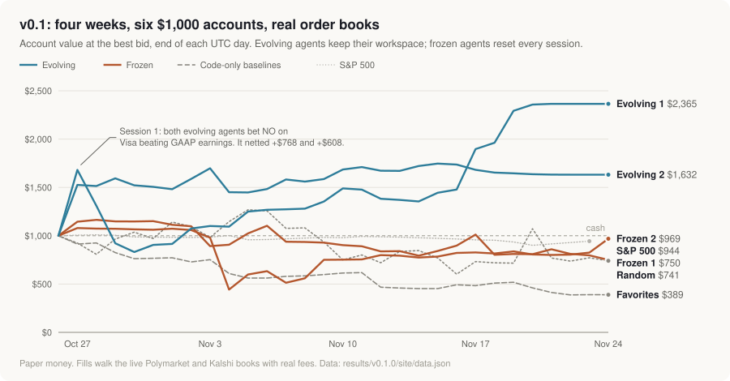

# Nightshift v0.1.0 results

The first benchmark run: four Claude Opus 5.5 agents and two code-only baselines, each with $1,000 of paper money, trading live Polymarket and Kalshi order books for 28 days. The rules, metrics and hypotheses were fixed beforehand in [`docs/METHODOLOGY.md`](../../docs/METHODOLOGY.md).

**Window:** 2026-10-27 01:08 UTC to 2026-11-24 01:08 UTC. Accounts are final at the first mark after the window, 2026-11-24 02:01 UTC.

  

## Scoreboard

| Account | Arm | Final value | Return | Max drawdown | Edge per $1 (95% CI) | Forecast skill (95% CI) | Closed / won | Inference cost |
| --- | --- | ---: | ---: | ---: | ---: | ---: | ---: | ---: |
| `opus-evolving-1` | evolving | $2,364.93 | **+136.5%** | 55.6% | +23.3¢ (−3.7 to +55.3) | −6.9% (−21.4 to +6.4) | 89 / 45 | $95.44 |
| `opus-evolving-2` | evolving | $1,631.82 | **+63.2%** | 24.7% | +16.4¢ (−18.8 to +58.2) | −6.1% (−20.4 to +6.8) | 61 / 29 | $86.53 |
| `opus-frozen-2` | frozen | $968.83 | −3.1% | 77.2% | −1.2¢ (−22.8 to +18.9) | −8.8% (−17.4 to −1.7) | 29 / 12 | $61.78 |
| `opus-frozen-1` | frozen | $749.99 | −25.0% | 37.9% | −7.2¢ (−27.5 to +13.6) | −1.7% (−9.5 to +4.7) | 36 / 22 | $78.13 |
| `random` | baseline | $740.70 | −25.9% | 56.1% | −3.7¢ (−22.9 to +15.4) | −0.2% | 170 / 81 | — |
| `favorites` | baseline | $389.23 | −61.1% | 65.9% | −4.4¢ (−7.5 to −1.4) | −0.3% | 491 / 446 | — |
| S&P 500 | context | $943.71 | −5.6% | — | — | — | — | — |

- **Forecast skill** is 1 − Brier(agent) ÷ Brier(market price at the moment of the forecast). Above zero beats the market. The baselines buy at the market price, so their skill sits near zero by construction.
- **Edge per $1** is after-fee profit per dollar staked on closed positions.
- Intervals are 95% cluster bootstraps over events, with 2,000 draws.
- **Inference cost** is Claude Code's list-price equivalent, $322 in total. It is reported beside the return, not subtracted from it.

## Pre-registered hypotheses

| | Hypothesis | Result |
| --- | --- | --- |
| H1 | Claude agents' forecast skill is above zero. | **Not supported.** All four agents scored below zero, from −1.7% to −8.8%. Frozen 2's interval excludes zero on the negative side. |
| H2 | Evolving agents forecast better than frozen ones. | **Inconclusive.** The pooled evolving score was −6.6% (251 resolved forecasts), against −4.3% for frozen (202). The difference is −2.3 points, with an interval of −14.7 to +9.3. |
| H3 | Evolving agents end with more money than frozen ones. | **Directionally yes, not called.** The mean return was +99.8% for evolving and −14.1% for frozen. Two replicates per arm give no interval, and one session-1 bet explains most of the gap (see below). |
| H4 | Agents beat cash and the favorites baseline. | **Split.** All four agents beat favorites. Only the evolving agents beat cash. |

## Where the money came from

In session 1, both evolving agents noticed that Polymarket's "Will X beat quarterly earnings?" markets settle on **GAAP** EPS, which one-off charges often push below the adjusted number traders price in. Both bought NO on Visa at about 24¢, sized near the 25% event cap. Visa missed on GAAP.

| Account | Visa bet | Everything else | Total P&L |
| --- | ---: | ---: | ---: |
| `opus-evolving-1` | +$768.14 | +$596.79 | +$1,364.93 |
| `opus-evolving-2` | +$608.03 | +$23.79 | +$631.82 |
| `opus-frozen-2` | — | −$31.17 | −$31.17 |
| `opus-frozen-1` | — | −$250.01 | −$250.01 |

Session 1 is identical across arms: same seed workspace, same prompt, nothing carried over yet. So the Visa trade is a lucky first draw, not something self-modification earned. The frozen agents happened to open on Senate races and the Israeli election instead.

What persistence did do is keep the earnings playbook alive. The evolving agents went on to open 70 and 49 earnings positions. The frozen agents, rediscovering everything each session, opened 0 and 1. **Outside of Visa, those earnings positions lost about $35 for each evolving agent.** Without Visa, Evolving 1 is still up $597, mostly from Senate-margin and Anthropic-valuation markets. Evolving 2 is up $24.

The favorites baseline won 446 of 491 bets and still lost 61%. Buying 90–97¢ favorites, valued at the bid and charged fees, has a significantly negative edge of −4.4¢ per dollar (interval −7.5 to −1.4) in this market mix.

## How the run went

| | |
| --- | --- |
| Sessions | 94 of 112 scheduled per agent. Missed slots fall in 7 to 18 hour overnight gaps, which fits the Mac sleeping. All arms missed the same slots. |
| Session length | 86 to 131 minutes on average by wall clock, with no timeouts. The 45-minute timer counts only time the machine is awake, so sleep in the middle of a session is the likely cause. |
| Harness | Claude Code moved from 2.1.311 to 2.1.329 (11 updates) during the run. These were not logged as interventions, which the methodology asks for. |
| Permission denials | 0 in every session. No agent tried to reach the harness, the records or another agent's files. |
| Shared `/tmp` references | 72, 196, 85 and 48 tool calls (evolving 1, evolving 2, frozen 1, frozen 2). The transcripts behind them are not yet audited. |
| Errors | 4 to 7 sessions per agent ended with an error flag. |
| Self-modification | Evolving agents changed files in 89 of 94 sessions and ended with a 31–36 KB `AGENTS.md` and 112 and 128 files. Most of their 412K and 50K lines changed are market-data dumps. |

## What's in this folder

- [`site/`](site) is the static results site exactly as the harness built it at the end of the run. Open `site/index.html` in a browser. Pages for each run are in `site/runs/`.
- [`site/data.json`](site/data.json) holds every number above: per-run series, trades, closed positions, forecasts, session logs with each agent's closing summary, and arm comparisons.

One local temp path in an agent summary is redacted. Ledgers, transcripts and workspace histories stay private. `nightshift verify` checks the ledgers' hash chains.

## What would settle it

Two replicates per arm can't separate a lucky first session from the value of keeping your own code. A second window, or more replicates started at the same moments, would. So would forecast-skill comparisons with enough resolved markets to put the interval on one side of zero.
